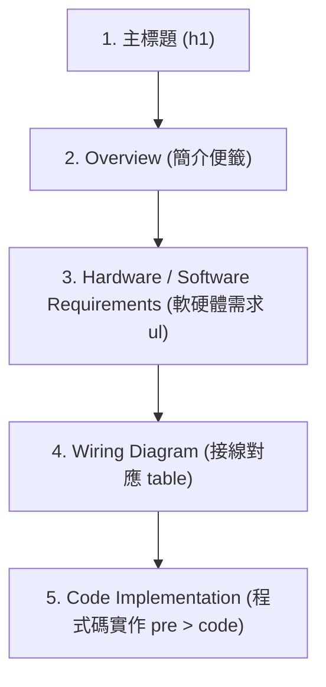
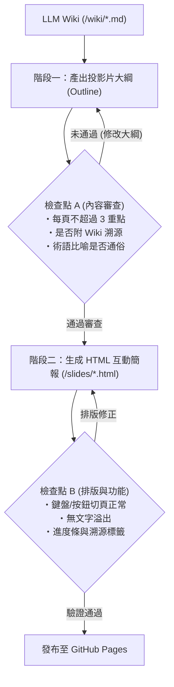

# AGENTS.md - IoT & Embedded Wiki 開發規範手冊

> 本檔案為「IoT & Embedded Wiki」專案之通用 AI Agent 開發指引與標準規範。
> 任何參與本專案的 AI 代理（或工程師）在進行頁面生成、修改現有架構或新增技術文章時，必須嚴格遵守本手冊之定義。

---

## 1. 專案目的與核心風格 (Core Philosophy)

本專案旨在建立一個結構化、易於擴充、富有親和力且極具實用價值的**個人嵌入式與物聯網工程手帳技術庫 (Hardware Lab Notebook)**。

- **內容主軸**：微控制器韌體開發（STM32、ESP32、Raspberry Pi）、物聯網通訊協定（MQTT、WebSockets、Modbus）、自動控制演算法（SMC、Fuzzy Control、Kalman Filter）。
- **視覺哲學**：
  - **拒絕冷酷生硬的科技 AI 感**：不用刺眼的霓虹光、高飽和漸層與花俏的發光動畫。
  - **採用溫潤的電路實驗室手帳風格 (Hardware Lab Techo)**：以護眼的工程方格紙為底、搭配金手指耐熱膠帶（Kapton Tape）、深石板墨水粗框與硬陰影、以及螢光筆劃記，兼具筆記本的溫暖手感與工程師的專業嚴謹。

---

## 2. 檔案目錄結構與命名規範 (File Architecture)

```text
/
├── index.html                   # 知識庫總目錄首頁 (Bento Grid 講義目錄與近期更新)
├── AGENTS.md                    # 本專案開發與設計規範手冊
├── wiki/                        # LLM Wiki 知識庫 (提供 AI 檢索的唯一真理核心)
│   ├── index.md                 # 知識庫總目錄與資料流向圖
│   ├── 01-mcu-basics.md         # 微控制器基礎與雙晶片分工
│   ├── 02-env-sensors.md        # 環境感測器與五步訊號轉換
│   ├── 03-mqtt-protocol.md      # MQTT 通訊協定與 Pub/Sub 機制
│   ├── 04-json-format.md        # 物聯網資料格式 JSON 與 Payload
│   └── 05-data-visualization.md # 資料視覺化與即時儀表板實作
├── slides/                      # 教學型互動 HTML 簡報目錄
│   └── iot-intro.html           # 物聯網入門教學簡報 (由 LLM Wiki 提煉生成)
├── pages/                       # 所有獨立技術文章存放目錄
│   ├── mqtt-json-payload.html   # 物聯網協定實作文章
│   ├── smc-fuzzy-pid-control.html # 控制演算法實作文章
│   └── [feature-name].html      # 未來新增頁面
└── assets/                      # 電路圖、接線圖等靜態資源
```

### 命名守則：
1. 所有 HTML 檔名一律使用**全小寫英文字母**。
2. 單字之間統一使用**連字號（kebab-case）**，例如：`stm32-firmware-setup.html`、`iot-intro.html`。
3. 技術文章存放於 `/pages/`，教學簡報存放於 `/slides/`，知識庫 Markdown 存放於 `/wiki/`，嚴禁散落在根目錄。

---

## 3. UI/UX 視覺設計系統 (Hardware Lab Techo System)

本專案不使用龐大的前端框架，統一引入 **Tailwind CSS (CDN)** 並結合專屬 CSS 變數：

### 3.1 專屬硬體手帳色票 (Color Tokens)

```css
:root {
  /* 基底紙本色系 */
  --paper-bg: #F8F5EE;          /* 燕麥工程圖紙底色 */
  --card-bg: #FFFDF8;           /* 手帳紙白卡片 */
  --ink: #1E293B;               /* 石墨深藍黑 (主線條、標題與文字) */
  --ink-muted: #5F6D76;         /* 說明副文字墨水灰 */

  /* 專屬硬體標籤與膠帶色彩 */
  --pcb-teal: #1F7A76;          /* PCB 電路板松石綠 (主題色) */
  --pcb-teal-soft: #D9ECE9;     /* 淺松綠標籤底色 */
  --kapton-amber: #EAA053;      /* 金手指耐熱膠帶琥珀金 (重要紙膠帶) */
  --ribbon-blue: #457B9D;       /* 杜邦排線藍 */
  --ribbon-blue-soft: #D8EBF5;  /* 淺排線藍底色 */
  --copper-blush: #ECA1A6;      /* 銅箔粉紅 */
  --highlighter: #FBE083;       /* 工程螢光筆劃線黃 */

  /* 字體組合 */
  --round: "M PLUS Rounded 1c", "Noto Sans TC", sans-serif;
  --mono: "JetBrains Mono", Consolas, monospace;
}
```

### 3.2 核心視覺元件規範

1. **實驗室方格底紙 (Lab Grid Background)**：
   使用 24px × 24px 精密工程方格網，營造真實工程師計算紙的質感。
2. **金手指紙膠帶 (Kapton Tape)**：
   卡片上方裝飾傾斜約 `-3deg` 至 `+3deg` 的半透明膠帶效果（`.tape-kapton` 或 `.tape-blue`）。
3. **Neo-brutalism 粗線框與實心硬陰影**：
   卡片外框統一使用 `2.5px ~ 3px solid var(--ink)`，並帶有位移 `5px 5px 0 rgba(30, 41, 59, 0.15)` 的立體實心陰影。
4. **螢光筆畫記 (`.u`)**：
   使用 `linear-gradient(transparent 58%, var(--highlighter) 58%)` 劃出重點。
5. **硬體測量尺／波形裝飾線 (`.ruler-divider`)**：
   取代生硬的水平線，使用帶有刻度感或波形特徵的分隔元素。

---

## 4. 技術文章內容規範 (Technical Article Standards)

未來的每一篇技術文章（`/pages/[slug].html`），都必須嚴格包含以下 **5 大核心區塊與順序**：



### 各區塊撰寫要領：
1. **主標題 (`<h1>`)**：明確指出技術名稱、硬體型號與實作主題。
2. **Overview (簡介)**：一句話精準概括本頁面的實作目標，並包覆於手帳便籤（Panel）中。
3. **Hardware / Software Requirements (軟硬體需求)**：
   使用無序清單 `<ul>` 列出受控機構、MCU 主控、感測器模組、供電要求及 IDE / 編譯鏈版本。
4. **Wiring Diagram (接線對應)**：
   若涉及硬體接線，**必須使用 HTML `<table>`** 呈現（包含 MCU Pin、Module Pin、訊號型態與功能說明），不可用純文字帶過。
5. **Code Implementation (程式碼實作)**：
   - 必須包覆在 `<pre><code class="language-[語言]">` 內。
   - 程式碼需保持真實可用性，包含暫存器配置、初始化、定時輪詢與邊界保護。
   - 若程式碼過長或部分未提供，使用 `// [請在此處補上具體驅動邏輯]` 標註佔位，嚴禁捏造荒謬的暫存器或 API。

---

## 5. AI 開發與協作指令 (AI Instructions)

當代理人被指派新增、擴充或維護本專案時，必須遵循下列執行準則：

1. **框架與結構完全繼承**：
   - 自動讀取現有 `index.html` 的頂部 `<nav>` 與底端 `<footer>` 結構，確保全站元件與品牌識別一致。
2. **嚴格維護路徑相對性 (Relative Paths)**：
   - 在 `/pages/` 內的網頁，回首頁導航必須使用 `../index.html`。
   - 引用資產圖片必須使用 `../assets/`。
   - 在根目錄 `index.html` 中，連往文章必須使用 `pages/[name].html`。
3. **防幻覺準則 (Zero Hallucination)**：
   - 硬體腳位定義（如 STM32 TIM 通道、I2C SDA/SCL、SPI MOSI/MISO）必須對應真實晶片手冊，切勿胡亂編造引腳。
4. **一體化輸出 (Self-contained Delivery)**：
   - 每次生成新頁面時，直接輸出完整、語法合規、可立即用瀏覽器渲染的 HTML 原始碼。

---

## 6. HTML 教學簡報生成規則 (Interactive Slide Generation Workflow)

為落實「由 LLM Wiki 知識庫提煉轉譯為教學簡報」之系統化架構，所有 AI Agent 在生成簡報時必須嚴格遵守以下兩階段工作流與規範：

### 6.1 唯一知識來源原則 (Ground Truth Enforcement)
- 簡報內容**必須先完整讀取 `/wiki/` 資料夾內的 5 篇核心知識檔案**（以及 `wiki/index.md` 總目錄）。
- 嚴禁自行虛構 Wiki 未記載之晶片型號、協定細節或接線關係；專有名詞必須對應 Wiki 中定義的生活化比喻（如司令官與偵察兵、托運單、儀表板）。

### 6.2 兩階段生成工作流 (Two-Stage Pipeline & Verification Loops)


1. **階段一（大綱規劃與內容審核 - 檢查點 A）**：
   - AI 必須先輸出 Markdown 簡報大綱，明確規劃 8 ~ 10 頁投影片。
   - 每頁內文**嚴格限制最多 3 個核心重點**，確保版面呼吸感。
   - 每頁標題下方**必須明確標註資料來源**（例如：`📌 資料來源：wiki/02-env-sensors.md`）。
   - 必須經使用者（或審核代理人）確認無誤後，方可進入程式碼生成。
2. **階段二（HTML 生成與互動實作 - 檢查點 B）**：
   - 簡報檔案一律存放於 `/slides/[slug].html`（例如 `slides/iot-intro.html`）。
   - 必須使用純 HTML5 + Tailwind CSS CDN + Vanilla JavaScript，不依賴龐大肥大的 npm 打包工具。

### 6.3 簡報視覺風格與互動控制規範
1. **傳承 Hardware Lab Techo 核心視覺**：
   - 背景必須使用 24px 工程方格紙 (`--paper-bg: #F8F5EE` + 方格網底)。
   - 投影片主卡片採用日系手帳白卡 (`--card-bg: #FFFDF8`)、2.5px 石墨深線框 (`--ink: #1E293B`) 與 5px 實心硬陰影。
   - 投影片頂端或卡片邊角點綴金手指耐熱紙膠帶效果 (`.tape-kapton`)。
2. **完整投影播放與切換控制器**：
   - **鍵盤控制**：監聽 `ArrowLeft`（上一頁）、`ArrowRight` / `Space`（下一頁）、`Home`（跳至首頁）、`End`（跳至末頁）。
   - **螢幕按鈕**：提供實體上一頁（◀ Prev）與下一頁（Next ▶）按鈕，並於首末頁自動設定按鈕停用（Disabled）狀態。
   - **頂部進度條**：畫面頂部固定高度細條進度指示（Progress Bar），隨著投影片切換動態調整寬度百分比。
   - **頁碼指示器**：右下角清楚顯示當前頁碼與總頁數（例如 `Slide 3 / 9`）。
   - **來源溯源標籤**：左下角固定顯示該頁對應之 Wiki 來源標籤（如 `wiki/03-mqtt-protocol.md`），點擊可開啟說明或錨點。
   - **導航返回紐**：左上角必須常駐「⬅ 返回首頁（`../index.html`）」連結按鈕。


