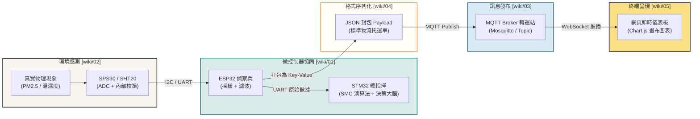

# IoT & Embedded Wiki ・ 知識庫總目錄 (LLM Wiki Master Index)

> **版本**：v1.2.0 (第十週擴充版)  
> **知識庫定位**：物聯網感測傳輸與邊緣決策技術手帳 (Hardware Lab Techo Knowledge Base)  
> **維護者**：國立臺中科技大學 資工四A 王庭翊 (學號：1311432014)  
> **檢索指引**：本索引專供 AI 代理人（AI Agent）進行檢索、摘要提取與自動生成教學投影片（Slides）。  

---

## 1. 知識庫核心文章索引表 (Knowledge Articles Catalog)

| 文章檔名 | 主題名稱 | 所屬領域 | 關鍵技術與硬體標籤 | 新手生活化比喻 |
| :--- | :--- | :--- | :--- | :--- |
| [`01-mcu-basics.md`](01-mcu-basics.md) | **微控制器基礎 (MCU Basics)** | 邊緣運算與晶片控制 | STM32F4, ESP32, 双晶片協同, ARM Cortex-M4, 即時決策, Wi-Fi | 司令官（STM32）與前線偵察兵（ESP32） |
| [`02-env-sensors.md`](02-env-sensors.md) | **環境感測器與訊號轉換** | 感測介面與訊號處理 | SPS30, SHT20, PM2.5, 雷射散射, ADC 轉換, 校準, I2C / UART | 系統的靈敏五官（眼睛與皮膚）與翻譯官 |
| [`03-mqtt-protocol.md`](03-mqtt-protocol.md) | **MQTT 物聯網通訊協定** | 網路通訊與訊息佇列 | MQTT, Pub/Sub, Broker, Mosquitto, Topic 萬用字元, QoS 等級 | YouTube 頻道與開啟小鈴鐺訂閱推播 |
| [`04-json-format.md`](04-json-format.md) | **物聯網資料格式 JSON** | 序列化與封包格式 | JSON, Key-Value, 跨平台相容, ArduinoJson, Payload 設計, 輕量化 | 國際標準化的宅配包裹托運單 |
| [`05-data-visualization.md`](05-data-visualization.md) | **資料視覺化與儀表板實作** | 前端視覺化與人機介面 | WebSockets, Chart.js, Canvas, 即時折線圖, FIFO 佇列, Node-RED | 超跑駕駛座的全數位動態儀表板 |

---

## 2. 知識庫關聯地圖與資料流動 (System Dataflow Graph)

---

## 3. AI Agent 查詢檢索指引 (AI Retrieval Guidelines)

當 AI 代理人受命執行「生成教學投影片」或「解答使用者技術諮詢」時，必須遵循以下指引：

1. **唯一真相來源 (Single Source of Truth)**：
   所有提及的腳位、晶片型號、協定特色與生活化比喻，必須完全以本 `/wiki/` 目錄下之 5 篇 Markdown 內容為準，**切勿混入外部無關晶片或自創規格**。
2. **多篇串聯檢索**：
   - 若要解說「系統整體架構」，需同時參考 `01-mcu-basics.md`（雙晶片職責）與 `03-mqtt-protocol.md`（訊息推播）。
   - 若要解說「數據從實體到畫面」，需依序串接 `02 -> 01 -> 04 -> 03 -> 05`。
3. **引用溯源規範**：
   在任何產出的教學投影片頁面或問答備註中，**必須明確標註所引用的 Wiki 篇號**（例如：`📌 資料來源：wiki/02-env-sensors.md`），以維護嚴謹的學術與工程引用追溯性。

